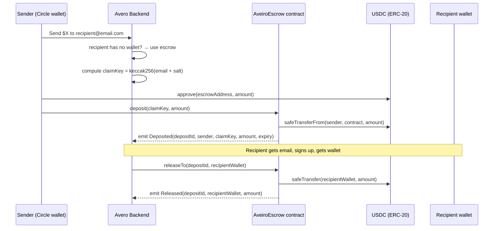

# AveiroEscrow — Smart Contract Design Doc

**Status:** Draft  
**Authors:** Avero / Arc Studio  
**Target chain:** Arc Testnet (chain ID 5042002) → Arc Mainnet (chain ID 5042)  
**Language/toolchain:** Solidity 0.8.24, Foundry (forge)  
**Milestone:** Arc Microgrant submission

**Review tracker:**
- [ ] Design review
- [ ] Security review
- [ ] Ops review

---

## Action Items (living)

_Empty — filled after review rounds._

---

## Goals / Non-Goals

**Goals:**
- Hold USDC in escrow when a sender sends to an email address that has no Avero wallet yet
- Allow the intended recipient to claim the USDC after they create an Avero wallet
- Allow the sender to cancel and reclaim USDC if the recipient never claims (after a timeout)
- Emit events for every state change so the Avero backend and explorer can track all flows
- Be simple, auditable, and deployable on Arc Testnet and Arc Mainnet

**Non-Goals:**
- Does not replace direct Circle SDK wallet-to-wallet transfers (those remain off-chain for registered users)
- Does not handle non-USDC tokens
- Does not implement upgradeability (immutable by design for simplicity and trust)
- Does not implement on-chain email verification (email→wallet mapping is managed off-chain by Avero backend)
- Does not implement fees

---

## Requirements

**Functional:**
- Sender deposits USDC with a `claimKey` (a bytes32 hash of the recipient email + a salt)
- Recipient calls `claim(claimKey, recipientWallet)` to receive the USDC
- Sender calls `cancel(depositId)` to reclaim USDC after `EXPIRY_SECONDS` (7 days)
- Owner (Avero backend wallet) can call `releaseTo(depositId, recipientWallet)` to release funds on behalf of a verified recipient
- Any deposit can only be claimed once
- Cancelled or claimed deposits cannot be replayed

**Security:**
- No path lets a non-sender cancel before expiry
- No path lets an attacker claim with a wrong key
- No path lets funds be double-spent (claimed AND cancelled)
- No reentrancy on any state-changing function
- Contract holds exactly the sum of all active deposits at all times (resting-state invariant)

---

## Terminology & Actors

| Term | Definition |
|---|---|
| Deposit | A locked USDC amount tied to a `claimKey` and a sender address |
| `claimKey` | `keccak256(abi.encodePacked(recipientEmail, salt))` — computed off-chain by the Avero backend |
| `depositId` | Auto-incrementing uint256, unique per deposit |
| Expiry | 7 days after deposit; sender may cancel after this |
| Owner | Avero backend wallet — can call `releaseTo` to release funds to a verified recipient |

| Actor | On/off-chain | Trust level | What they can do |
|---|---|---|---|
| Sender | On-chain (EOA / Circle wallet) | Untrusted | Deposit USDC, cancel own deposit after expiry |
| Recipient | On-chain (EOA / Circle wallet) | Untrusted | Claim with valid claimKey |
| Owner (Avero backend) | Off-chain caller, on-chain EOA | Trusted | Call `releaseTo` to release to a verified recipient address |
| Anyone | On-chain | Untrusted | Read deposit state |

---

## Language / Runtime

- Solidity 0.8.24 (built-in overflow checks, custom errors, no SafeMath needed)
- Foundry (forge build, forge test)
- EVM target: Paris (Arc Testnet and Arc Mainnet use Paris hardfork)
- OpenZeppelin 5.1.0 (pre-pinned in sandbox): `ReentrancyGuard`, `Ownable2Step`, `SafeERC20`, `IERC20`
- No upgradeable proxy — immutable by design

---

## Transaction & Execution Model

All functions are atomic. State is updated BEFORE external ERC-20 calls (CEI pattern). `ReentrancyGuard` applied to `deposit`, `claim`, `cancel`, and `releaseTo`.

Re-entry surface: `SafeERC20.safeTransferFrom` (deposit) and `SafeERC20.safeTransfer` (claim/cancel/release). Both wrapped in `nonReentrant`.

---

## Chain Standards & Interfaces

- ERC-20 (USDC on Arc): `safeTransferFrom` for deposit, `safeTransfer` for release
- USDC address on Arc Testnet: `0x3c499c542cEF5E3811e1192ce70d8cC03d5c3359` — read from `onchain-facts` module; never hardcoded in app code
- No ERC-721, ERC-1155, or cross-chain messaging

---

## Architecture Overview



**Flow of funds table:**

| Step | Who moves what | Invariant |
|---|---|---|
| deposit | Sender → contract (via safeTransferFrom) | `contract USDC balance += amount` |
| claim / releaseTo | Contract → recipient (via safeTransfer) | `contract USDC balance -= amount`; deposit marked claimed |
| cancel | Contract → sender (via safeTransfer) | `contract USDC balance -= amount`; deposit marked cancelled; only after expiry |

**Resting-state invariant:** `contract.balanceOf(USDC) == sum of all active (not claimed, not cancelled) deposit amounts`

---

## Contract Design

### Roles

| Role | Holder | Permissions | Why |
|---|---|---|---|
| `owner` | Avero backend wallet | `releaseTo` | Release funds to verified recipients without requiring recipient to know the claimKey |
| Sender | Per-deposit | `cancel` after expiry | Reclaim if recipient never shows up |
| Recipient | Anyone with valid claimKey | `claim` | Self-service redemption |

### Storage layout

```solidity
struct Deposit {
    address sender;       // 20 bytes
    bytes32 claimKey;     // 32 bytes
    uint256 amount;       // 32 bytes
    uint64  expiry;       // 8 bytes (unix timestamp)
    bool    claimed;      // 1 byte
    bool    cancelled;    // 1 byte
}

mapping(uint256 => Deposit) public deposits;   // depositId → Deposit
mapping(bytes32 => uint256) public keyToId;    // claimKey → depositId (for lookup)
uint256 public nextDepositId;
address public immutable USDC;
uint64  public constant EXPIRY_SECONDS = 7 days;
```

### Modifiers

| Modifier | Guard |
|---|---|
| `nonReentrant` (OZ) | Prevents reentrancy on state-changing functions |
| `onlyOwner` (OZ Ownable2Step) | Restricts `releaseTo` to owner |

### Functions (write)

| Function | Caller | State mutated | Events | Revert conditions |
|---|---|---|---|---|
| `deposit(bytes32 claimKey, uint256 amount)` | Any (sender) | Creates Deposit entry, pulls USDC | `Deposited` | amount == 0; claimKey already used and active; transfer fails |
| `claim(bytes32 claimKey, address recipient)` | Any (with valid key) | Marks claimed, transfers USDC | `Claimed` | key not found; already claimed/cancelled; transfer fails |
| `cancel(uint256 depositId)` | Sender only | Marks cancelled, refunds USDC | `Cancelled` | not sender; not expired; already claimed/cancelled |
| `releaseTo(uint256 depositId, address recipient)` | Owner only | Marks claimed, transfers USDC | `Released` | not owner; already claimed/cancelled; zero address; transfer fails |

### Events

| Event | Params | When |
|---|---|---|
| `Deposited(uint256 depositId, address sender, bytes32 claimKey, uint256 amount, uint64 expiry)` | all indexed except amount/expiry | On deposit |
| `Claimed(uint256 depositId, address recipient, uint256 amount)` | depositId indexed | On self-service claim |
| `Released(uint256 depositId, address recipient, uint256 amount)` | depositId indexed | On owner release |
| `Cancelled(uint256 depositId, address sender, uint256 amount)` | depositId indexed | On cancel |

---

## Deployment & Initialization

- Constructor args: `address usdc` (USDC contract on Arc)
- No proxy, no `initialize` — constructor only
- Owner set to deployer (Avero backend wallet) at construction
- Two-step ownership transfer via `Ownable2Step` if owner needs to change

---

## Upgradeability

Not upgradeable. Immutable by design. Migration story: deploy a new contract version, Avero backend switches to the new address. Old deposits remain claimable on the old contract until they expire.

---

## Key Management & Signing

- `claimKey` is `keccak256(abi.encodePacked(recipientEmail, salt))` — computed off-chain by Avero backend
- Salt is a random UUID stored in Supabase per deposit — never exposed onchain
- No EIP-712 signing required — claimKey is passed directly by the backend (`releaseTo`) or by the recipient via the claim page

---

## Security Considerations

| Vulnerability | Applicable? | Mitigation |
|---|---|---|
| Reentrancy | Yes — safeTransfer on claim/cancel/release | CEI + `nonReentrant` on all state-changing functions |
| Access control | Yes — cancel and releaseTo are privileged | `onlyOwner` for releaseTo; sender check for cancel |
| Integer overflow/underflow | No — Solidity 0.8.24 checked arithmetic | No `unchecked` blocks |
| Unchecked external call | Yes — USDC transfer | `SafeERC20.safeTransfer` / `safeTransferFrom` |
| Fee-on-transfer tokens | No — USDC on Arc is not fee-on-transfer | N/A |
| Signature replay | No — no signatures used | N/A |
| Front-running | Low — claimKey is a hash, not guessable | Salt in claimKey prevents brute-force; releaseTo is owner-only |
| Flash-loan / price manipulation | No — no price oracle | N/A |
| Denial of service | Low — pull-over-push pattern used | Each deposit is independent; no loops over unbounded arrays |
| Delegatecall / proxy safety | No — not upgradeable | N/A |
| Timestamp dependence | Yes — expiry uses block.timestamp | 7-day window is large enough that miner manipulation is irrelevant |
| Approval persistence | Yes — sender must approve before deposit | Exact-amount approval; no dangling max-approvals |
| Centralization risk | Yes — owner can releaseTo | Owner is Avero backend; blast radius: release to wrong address. Mitigated: only active deposits can be released; sender can cancel after expiry |

---

## Trust Model & Threat Analysis

| Actor | Max damage if compromised | Mitigation | Detection |
|---|---|---|---|
| Owner key | Release active deposits to attacker-controlled addresses | Owner can only release unclaimed deposits; sender can cancel after 7 days to recover if release not yet called | Monitor `Released` events; alert on unexpected recipient addresses |
| Sender | None beyond their own deposits | Sender can only cancel their own deposits after expiry | N/A |
| Recipient | Claim their own deposit | claimKey is a hash; only the intended recipient (who knows the key via the backend) can claim | N/A |

---

## Emergency Response & Circuit Breakers

No pause mechanism — immutable contract. In an emergency:
1. Avero backend stops creating new deposits (off-chain gate)
2. Existing deposits expire naturally (7 days) and senders can cancel
3. Deploy a new contract version if needed

---

## Failure Scenarios

- **USDC transfer fails on deposit:** `safeTransferFrom` reverts, entire transaction reverts, no state change
- **USDC transfer fails on claim:** `safeTransfer` reverts, deposit remains active, recipient can retry
- **Owner releases to wrong address:** Funds lost — owner key security is critical. Mitigation: owner always verifies recipient wallet via Supabase before calling `releaseTo`
- **Recipient never claims, sender never cancels:** Funds locked until sender cancels (after 7 days). No funds are permanently stuck.

---

## Testing Strategy

- Foundry unit tests: happy path (deposit → claim, deposit → releaseTo, deposit → cancel after expiry)
- Revert paths: wrong sender cancel, early cancel, double claim, double cancel, zero amount
- Event assertions on every state change
- Fuzz: deposit amounts, expiry timing
- Slither static analysis
- Coverage target: 100% branch coverage on all write functions

Run: `forge test -v` and `slither contracts/AveiroEscrow.sol`

---

## Third-party Libraries

| Library | Version | Already a dep? | Why | Security reviewed? |
|---|---|---|---|---|
| OpenZeppelin contracts | 5.1.0 | Yes (pre-pinned) | ReentrancyGuard, Ownable2Step, SafeERC20 | Yes (industry standard) |

---

## Common Patterns / Worked Examples

**Example 1 — New recipient send:**
1. Avero backend computes `claimKey = keccak256(abi.encodePacked("bob@email.com", randomSalt))`
2. Sender's Circle wallet approves escrow for `10_000000` (10 USDC, 6 decimals)
3. Sender's Circle wallet calls `deposit(claimKey, 10_000000)` → `Deposited` event emitted
4. Bob gets email, signs up, gets wallet `0xBob...`
5. Avero backend calls `releaseTo(depositId, 0xBob...)` → `Released` event emitted, Bob receives 10 USDC

**Example 2 — Sender cancels unclaimed deposit:**
1. Steps 1-3 same as above
2. Bob never signs up — 7 days pass
3. Sender calls `cancel(depositId)` → `Cancelled` event, sender gets 10 USDC back
